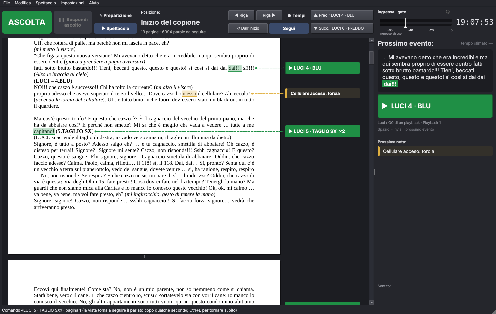

# Script Follower

Ascolta le voci degli attori da una scheda audio, capisce in che punto del copione si trova lo spettacolo e fa
scorrere il **PDF del copione** di conseguenza. Nei punti scelti in preparazione mostra **annotazioni** e
**pulsanti OSC** per CueStage, QLab, SCS, ChamSys MagicQ o qualunque dispositivo OSC.

Stesso stack e stessa veste grafica di [CueStage](https://github.com/fantoma/cuestage): Python 3, PySide6
(Qt, stile Fusion scuro), sounddevice/PortAudio, python-osc. In più: **Vosk** (riconoscimento vocale offline)
e **PyMuPDF** (PDF); per lo sloveno **Whisper** (CTranslate2).

Interfaccia in **italiano, inglese e sloveno**; copioni in **italiano, inglese e sloveno**.

Pacchetti **portable** per Linux (AppImage), Windows (cartella in uno zip) e macOS (.app in un .dmg), costruiti
da GitHub Actions con il modello vocale italiano già incluso: nessuna installazione, funziona anche da chiavetta.



## Come funziona

1. **Ascolto**: il canale scelto della scheda audio passa per un **gate** (soglia + hold): sotto la soglia al
   riconoscitore arriva silenzio.
2. **Riconoscimento**: Vosk, offline, con il vocabolario **limitato alle parole del copione** (molto più
   affidabile con i modelli piccoli).
3. **Allineamento**: le ultime ~10 parole sentite vengono confrontate con il copione intorno alla posizione
   corrente (allineamento locale tollerante a errori, parole saltate o aggiunte). Ci si sposta solo quando la
   corrispondenza è sicura. Se l'attore salta una scena, ci si riaggancia cercando in tutto il copione, ma
   serve una corrispondenza nettamente migliore e confermata due volte.
4. **Scorrimento**: la riga detta è evidenziata e tenuta a circa un terzo dell'altezza della finestra.

Nelle prove simulate sul copione «Il segreto di Francesco», con il 30% di parole sbagliate o perse la posizione
resta in media entro una parola. Dopo un salto di centinaia o migliaia di parole, anche all'indietro, si riaggancia in 6–14 parole.

## Preparazione

- **File › Apri copione PDF…**: solo PDF con testo (esportato da Word/LibreOffice; le scansioni vanno passate
  prima da un OCR).
- Le parole **escluse dal riconoscimento** sono velate in azzurro: testo tra parentesi, corsivo e grassetto
  (didascalie, titoli, luci), righe tipo `MUSICA: …`, l'indice. Clic su una parola (o trascina su più parole):
  il menu permette di includerle o escluderle, anche una riga intera.
- **🎭 Parti improvvisate**: seleziona un pezzo di testo e scegli «Segna come parte improvvisata». La parte
  diventa viola, con una barra nel margine, ed esce dal riconoscimento. In scena la posizione si ferma
  all'inizio della parte e non si lascia trascinare dalle frasi improvvisate, che spesso somigliano al
  copione. Riparte solo quando il testo che segue la parte viene riconosciuto da solo, con almeno 4–5
  parole sicure. Con il menu sulla parte si toglie.
- **Modifica › Vocabolario del copione…** (Ctrl+Shift+V) mostra le parole del copione che il modello vocale
  **non conosce**, ordinate per frequenza, controllandole con il modello stesso (`vosk_model_find_word`).
  Sono tipicamente nomi propri e neologismi, e non verrebbero mai «sentite».
  - A ogni parola si può dare una **pronuncia** fatta di parole note al modello («Gesualdi» → «gesù aldi»).
    La pronuncia entra nel vocabolario del riconoscitore e viene agganciata alla parola del copione. Lo
    stato dice subito se la pronuncia è riconoscibile.
  - **Proposte automatiche**: parola divisa in parti note («aspirapolvere» → «aspira polvere») e accento
    finale.
  - I **numeri in cifre** si leggono già in lettere (118 → centodiciotto).
  - Le parole sconosciute senza pronuncia vengono **saltate senza penalità** dall'inseguimento, e questo
    avviene in automatico a ogni ASCOLTA.
  - **Limite verificato**: aggiungere davvero parole nuove al modello italiano richiede di ricompilarne il
    grafo con il pacchetto di compilazione di Alphacephei (per l'italiano non è pubblico, si chiede a loro),
    più Kaldi, SRILM, Phonetisaurus e un Linux con 32 GB di RAM. Non si fa dall'app. In alternativa c'è il
    modello italiano grande, che ha più parole ma non permette di limitare il vocabolario.
- **Immagini e foto** nei pulsanti e nelle note: nella finestra del punto c'è **＋ Aggiungi…**, oppure le
  trascini dentro. Si possono riordinare con ◀ ▶ e togliere con Rimuovi.
  - Salvando, vengono **incorporate nel PDF** (e nel JSON esportato): non serve portarsi dietro cartelle. Sul
    computer stanno in un deposito nella cartella dei dati, con un nome che comincia con l'impronta del
    contenuto, così due foto con lo stesso nome non si confondono.
  - In scena compaiono come **miniature sotto la nota** del prossimo evento (e della prossima nota). Un clic
    le apre in una **finestra a parte**: ◀ ▶ per scorrerle, F per lo schermo intero. Le foto sono ruotate
    secondo i dati EXIF.
  - Nella colonna dei punti, il segno 🖼 indica i pulsanti e le note che hanno immagini.
- **Zone azzurre e viola trascinabili**: in preparazione, porta il mouse sul bordo sinistro della prima parola o
  sul bordo destro dell'ultima di una zona. Il cursore diventa ↔ e trascinando la zona si allarga o si
  restringe, con l'anteprima delle parole che entrano o escono.
- Dallo stesso menu: **＋ Pulsante OSC** o **＋ Annotazione** su quella parola. Il punto «passa» quando il parlato
  arriva a quella parola.
- Ogni pulsante ha un nome, una nota facoltativa e **più comandi OSC**, inviati nell'ordine. Ogni comando va
  a uno dei **due profili OSC** e può essere un comando già pronto del plugin, con i suoi parametri, oppure un
  indirizzo con argomenti scritti a mano. Il pulsante «Prova: invia adesso» manda i comandi subito.
- **File › Salva nel PDF** (Ctrl+S) mette **dentro il copione** tutti i dati dello show: pulsanti, note,
  immagini, parole incluse o escluse, zone improvvisate, pronunce, profili OSC, lingua, tempi registrati e le
  **impostazioni dello show** (gate: soglia, hold, guadagno; inseguimento; riquadro «Prossimo evento»). Scheda
  audio, canali e preascolto restano invece sul computer, perché cambiano da una macchina all'altra.
  - I dati sono allegati standard del PDF (`scriptfollower.json` e `scriptfollower-img/…`): il copione si apre
    e si stampa come prima in qualunque lettore; Acrobat li mostra nel pannello degli allegati.
  - Ogni salvataggio **sostituisce** i dati precedenti e riscrive il PDF da capo: nel file non resta nessuna
    storia e la dimensione non cresce. La scrittura passa per un file temporaneo, così un'interruzione non
    rovina mai il copione.
  - Al primo salvataggio si crea la **copia di riserva pulita** `copione.originale.pdf`: il PDF originale,
    identico, senza dati di Script Follower.
  - Riaprendo il PDF, anche su un altro computer, tutto torna com'era, immagini comprese.
  - Se il PDF non si può scrivere (protetto da password, firmato digitalmente, aperto in un altro programma su
    Windows, cartella in sola lettura) l'app lo dice e propone **File › Salva copione con nome…**, che crea
    una copia del PDF con i dati dentro.
  - **File › Esporta / Importa i dati dello show (JSON)**: gli stessi dati in un file JSON, con le immagini
    incorporate, per archiviarli o passarli a un collega. L'importazione accetta anche i vecchi `.sfollow`,
    e aprendo un PDF che ha accanto un `.sfollow` l'app propone di importarlo.
  - Se il testo del PDF cambia (riesportato da Word, per esempio) l'app avvisa che i punti potrebbero essere
    spostati: il controllo riguarda solo pagine e parole, non i dati salvati dentro.
- **Modifica › Importa / Esporta vocabolario…** (anche dalla finestra «Vocabolario del copione»): le pronunce
  in un file **JSON** oppure di **testo** con una riga `parola = pronuncia` per voce (si leggono anche righe
  separate da tabulazione o «;»). Importando, le pronunce del file si aggiungono a quelle del copione e
  sostituiscono quelle delle stesse parole.

## Spettacolo

- **ASCOLTA** (F5) avvia il riconoscimento. **Spettacolo** (Ctrl+E) attiva i pulsanti.
- I **punti già passati** diventano grigi e inattivi. Il **prossimo pulsante** e la **prossima nota**
  lampeggiano.
- Sotto «Prossimo evento:» compare la **nota del pulsante**, cioè il promemoria per l'operatore scritto in
  preparazione.
- Il riquadro **Prossimo evento** mostra le frasi, righe o parole che precedono il pulsante. Con le frasi si
  vede almeno anche la frase prima; i puntini di sospensione non spezzano più la frase. (quante, lo decidi
  nelle Impostazioni), con le parole già dette in
  giallo e la parola d'aggancio in verde, poi il pulsante grande. **Spazio** lo invia.
- L'**ultimo pulsante passato** resta premibile, in arancione se non è stato inviato, finché non premi il pulsante
  corrente. Premendo un pulsante si disattivano i precedenti.
- **Ricerca solo nella parte rimanente**: ogni pulsante premuto sposta in avanti il limite della ricerca.
  La parte già fatta dello spettacolo esce sia dall'allineamento, cioè dalla ricerca locale e da quella in
  tutto il copione, sia dal vocabolario del riconoscitore, che si aggiorna senza ricaricare il modello.
  Così una frase già detta, se ripetuta, non riporta indietro. Se il pulsante viene premuto in anticipo, il
  limite resta dove è arrivato il parlato. Un riposizionamento a mano più indietro abbassa il limite, e
  «Dall'inizio» lo azzera. La posizione del limite è indicata sotto «Posizione» («ricerca da pag. N»).
- **▲ Prec.: … / ▼ Succ.: …** (Alt+↑ / Alt+↓), nella barra in alto, spostano la **vista** sul comando
  precedente o successivo, evidenziandone la riga. La posizione dello spettacolo non cambia. I tasti
  compaiono solo se esiste un comando in quella direzione. Dopo qualche secondo la vista torna a seguire il
  parlato, oppure subito con Ctrl+L.
- **↺ Riattiva questo pulsante** (tasto destro su un pulsante già passato, disattivato o inviato): torna
  premibile, in arancione, finché non lo premi.
- **❚❚ Sospendi ascolto** (F8), accanto ad ASCOLTA, passa al modo manuale. Il modello resta caricato, ma la
  posizione si sposta solo a mano e i pulsanti funzionano normalmente. **▶ Riprendi ascolto** riparte dalla
  posizione attuale. Il tempo passato in manuale non entra nelle medie dei tempi.
- **Doppio clic** su una parola fa ripartire da lì. Ctrl+↑ e Ctrl+↓ spostano di una riga, **⟲ Dall'inizio**
  riparte dall'inizio. Tornando indietro i punti successivi si riattivano.
- Se scorri a mano, la vista smette di seguire per 5 secondi. «Segui» (F6) la blocca del tutto.
- **Tempi (euristica)**: con **⏺ Tempi** acceso (accanto a «Riga» nella barra in alto, oppure F7), a ogni
  replica si registra quanto passa tra un evento e il successivo. Un evento è un pulsante o una nota raggiunti
  dal parlato, oppure un pulsante premuto prima. Accanto a «Prossimo evento:» compare il **tempo stimato**:
  la durata media dall'ultimo evento al prossimo pulsante, sommando gli eventi intermedi. Sotto c'è il
  conto alla rovescia «tra 0:37», che diventa arancione («oltre di …») se si va oltre.
  - Si usano le ultime 10 repliche, scartando i valori molto lontani dalla mediana.
  - I salti a mano e i salti lunghi del riconoscimento non producono misure.
  - Le misure sono legate alla coppia «evento precedente → evento», quindi aggiungere un punto in mezzo
    non le confonde.
  - I tempi stanno nel PDF insieme agli altri dati e, se non ci sono altre modifiche in sospeso, si salvano da
    soli (al massimo ogni 30 secondi durante la replica, e alla chiusura).
    **Spettacolo › Cancella i tempi registrati** li azzera.
- **Spettacolo › Prova con un file audio** (F9, oppure trascina il file sulla finestra) fa ascoltare al
  programma la registrazione di una prova o di una replica, come se arrivasse dalla scheda: passa per guadagno,
  gate, meter e preascolto, e il copione la segue. Finché la finestra è aperta la scheda in ingresso non viene
  ascoltata (sul meter compare «File audio · gate»).
  - Formati: WAV, FLAC, MP3, OGG/Opus, AIFF (libsndfile, incluso); se sul computer c'è **ffmpeg**, anche M4A,
    AAC e l'audio dei video (MP4, MOV, MKV…).
  - Riproduci / pausa / ferma, ±10 s, barra di posizione; **canale del file** (mix, oppure il canale delle voci
    di una registrazione multitraccia); **velocità** 1×, 1,5×, 2×, 3× per scorrere in fretta un copione lungo
    (accelerato il file non si sente).
  - «Fai sentire il file» lo manda sull'uscita del preascolto (o su quella predefinita del sistema).
  - Spostandosi nel file il copione si riaggancia da solo dopo qualche parola; per partire subito dal punto
    giusto, doppio clic sulla parola. Con «⏺ Tempi» acceso i tempi tra gli eventi si misurano nel tempo della
    registrazione, anche accelerata; pause e salti non entrano nelle medie.
  - Il programma ripropone l'ultimo file provato con lo stesso copione.
- **Spettacolo › Simula il parlato** (F4) serve a provare senza microfono e senza registrazioni: scrivi le
  frasi, oppure lascia leggere il copione con una percentuale di errori casuali.

## Impostazioni

- **Audio e gate**: scheda, canale di ascolto e guadagno. Il meter mostra il livello d'ingresso (grigio quando
  il gate è chiuso), quello che arriva al riconoscitore (barra blu) e il LED del gate. La **soglia** si regola
  trascinando il cursore bianco sul meter, anche quello piccolo nella barra in alto (o con rotella e frecce).
  C'è anche il tempo di hold.
  - **Preascolto (cuffia)**, come in CueStage: il canale d'ingresso esce su una **scheda dedicata**. Si
    scelgono i canali (coppia stereo o canale mono), il volume e se ascoltare **prima o dopo il gate**.
    Dopo il gate si sente esattamente ciò che arriva al riconoscitore, ed è comodo per regolare la soglia.
    Il tasto 🎧 accanto al meter in alto lo accende e lo spegne.
- **Profili OSC**: quanti ne servono (**＋ Aggiungi profilo OSC**, **Elimina profilo**), ciascuno con nome,
  indirizzo IP, porta, appunto e **plugin**. Prima di eliminare un profilo usato dai pulsanti, l'app avvisa.
  - **🔍 Cerca in rete…** trova **CueStage** (ricerca delle istanze, interfaccia web) e **QLab** (OSC su
    TCP 53000, riconosciuto dalla versione).
  - Trova anche le console **ChamSys** e gli altri nodi Art-Net, e le **porte OSC UDP** più usate sui computer
    accesi. Per l'UDP è solo un indizio: le risposte «porta chiusa» sono limitate a una al secondo, quindi
    le prove sono distanziate per non dare falsi positivi.
  - **Configura automaticamente** mette ogni dispositivo certo nel profilo dello stesso tipo ancora da
    configurare, oppure in un profilo nuovo.
- **Riquadro**: quanta anteprima mostrare prima del pulsante nel riquadro «Prossimo evento». Si contano le
  ultime **frasi** dette (predefinito: 2), le ultime **righe** del copione così come sono impaginate,
  didascalie comprese, oppure le ultime **parole** dette.
- **Riconoscimento**: modello, download del modello italiano, vocabolario limitato al copione, ampiezza della
  ricerca, sicurezza richiesta e altezza della riga corrente.

Consiglio pratico: una mandata aux del mixer con **solo i radiomicrofoni delle voci**, asciutta, senza musica
né effetti.

## Plugin OSC

File JSON in `scriptfollower/osc_profiles/`, nello **stesso formato dei profili OSC di CueStage**. Se ne
aggiungono altri nella cartella dei dati `osc_profiles/`:

| Plugin | Porta | Comandi principali |
|---|---|---|
| CueStage | 53000 | `/go`, `/cue/N/start`, `/cue/N/stop`, `/cue/N/level`, `/playhead/N`, `/list/NOME/go`, `/xfade`, `/dim`… |
| QLab 4/5 | 53000 | `/go`, `/cue/N/start`, `/stop`, `/load`, `/playhead/N`, `/playhead/next`, `/panic`… |
| SCS (Pro Plus) | a scelta | `/ctrl/go`, `/ctrl/gotop`, `/ctrl/goto "Q1"`, `/cue/go "Q1"`, `/hkey/go "A"`, `/fader/setmaster -12.0`… |
| ChamSys MagicQ | 8000 | `/pb/N/go`, `/pb/N/CUE`, `/exec/P/I`, `/pb/N` livello, `/dbo`, `/rpc`… |
| Generico | — | indirizzo e argomenti a mano |

Negli argomenti il testo **tra virgolette resta una stringa** (`"12"`), i numeri senza virgolette diventano
interi o decimali, e `true`/`false` diventano booleani.

## GitHub e nuove versioni

Come per CueStage (dettagli in [GITHUB.md](GITHUB.md)):

```bash
./crea_repo_github.sh      # una volta sola: crea fantoma/scriptfollower e carica il progetto
./release.sh               # ogni nuova versione: numero, commit, tag → GitHub costruisce e pubblica
```

## Avvio dai sorgenti

```bash
python3 -m venv .venv && .venv/bin/pip install -r requirements.txt
./run.sh                       # oppure: ./run.sh copione.pdf  /  ./run.sh dati.scriptfollower.json
python3 tests/test_smoke.py    # test di regressione (senza audio né modello)
```

Per installarlo su Ubuntu dai sorgenti, con la voce nel menu e il modello vocale: `./install.sh`.

Su Linux serve `libportaudio2`. Il modello vocale si scarica da **Impostazioni › Riconoscimento**, oppure si
mette in `models/`.

## Lingue

Due scelte indipendenti, nel menu **Lingua**:

- **Lingua dell'interfaccia**: italiano, English, slovenščina (vale dal riavvio successivo; il programma
  propone di riavviarsi subito).
- **Lingua del copione** (riconoscimento): si salva nel progetto. Nei pacchetti portable c'è solo il modello
  italiano; gli altri si scaricano una volta sola da **Lingua › Lingue del riconoscimento** (Scarica / Rimuovi).

| Lingua | Motore | Modello | Dimensione |
|---|---|---|---|
| Italiano | Vosk | `vosk-model-small-it-0.22` (incluso) | 48 MB |
| English | Vosk | `vosk-model-small-en-us-0.15` | 40 MB |
| Slovenščina | Whisper (CTranslate2) | `faster-whisper-small` (Hugging Face, Systran) | 484 MB |

Vosk non ha un modello sloveno, per questo lo sloveno usa **Whisper** «small» multilingue, eseguito con
CTranslate2 (int8, CPU) senza faster-whisper: il programma calcola da solo lo spettrogramma e trascrive una
finestra mobile di 6 s ogni 0,8 s, passando come contesto il testo già detto. Rispetto a Vosk ha circa 1–2 s di
ritardo in più e chiede più CPU (consigliato un computer a 4 core recente); il vocabolario è aperto, quindi la
finestra «Vocabolario del copione» e il vocabolario limitato non servono. I numeri in cifre nei copioni
italiani e inglesi si leggono già in lettere (118 → centodiciotto / one hundred eighteen).

Le traduzioni sono in `scriptfollower/i18n/en.json` e `sl.json` (chiave = testo italiano del codice).

## Dove si cerca il modello vocale

1. `$SCRIPTFOLLOWER_MODEL`
2. `models/` dentro il pacchetto (incluso nelle build)
3. `models/` **accanto al programma**, cioè accanto all'AppImage, all'exe o alla .app (uso portable)
4. `models/` nella cartella dei dati (`~/.local/share/scriptfollower`, `%APPDATA%\ScriptFollower`,
   `~/Library/Application Support/ScriptFollower`)

Il modello incluso è `vosk-model-small-it-0.22` (circa 50 MB). Il modello italiano grande (`vosk-model-it-0.22`)
è più preciso ma pesa molto di più, e con lui conviene togliere «Limita il vocabolario».

## Pacchetti

| Sistema | Comando | Risultato |
|---|---|---|
| Linux | `packaging/build_appimage.sh` | `dist/ScriptFollower-X.Y.Z-x86_64.AppImage` (un solo file) |
| Windows | `packaging\build_windows.ps1` | `dist\ScriptFollower-X.Y.Z-windows-portable.zip` |
| macOS | `packaging/build_macos.sh` | `dist/ScriptFollower-X.Y.Z-macos-arm64.dmg` (e `x86_64`) |

`MODEL_URL=""` costruisce senza modello incluso. Su GitHub il flusso è lo stesso di CueStage: push su `main`
avvia i test su Linux; **Actions › Build › Run workflow** produce i pacchetti dei tre sistemi negli Artifacts;
un tag `vX.Y.Z` uguale a `__version__` crea una Release con i pacchetti allegati. Su macOS, senza un
certificato Developer ID, la prima apertura si fa con tasto destro › Apri, e alla prima pressione di ASCOLTA
macOS chiede il permesso per il microfono.

## Struttura

| File | Contenuto |
|---|---|
| `script_doc.py` | lettura del PDF, parole con coordinate, parti dette ed escluse, frasi |
| `align.py` | normalizzazione e allineamento del parlato al copione |
| `audio_input.py` | ingresso audio, gate, meter, ricampionamento a 16 kHz |
| `audio_file.py`, `ui_audiofile.py` | prova con un file audio al posto della scheda |
| `recognizer.py` | riconoscimento in un thread (Vosk o Whisper) |
| `languages.py`, `whisper_engine.py` | lingue del copione, modelli e download; Whisper con CTranslate2 |
| `i18n/` | traduzioni dell'interfaccia (inglese, sloveno) |
| `osc.py` + `osc_profiles/` | profili di destinazione, plugin, invio |
| `project.py` | dati dello show, JSON esportato, regole dei pulsanti durante lo spettacolo |
| `pdf_store.py` | dati e immagini dentro il PDF, copia di riserva pulita, scrittura atomica |
| `ui_*.py`, `main_window.py` | interfaccia |

## Licenze

GPL v3 (come CueStage). PyMuPDF è AGPL v3, compatibile con un progetto GPL v3 open source. Vosk e i suoi
modelli sono Apache 2.0. CTranslate2, tokenizers e i modelli Whisper sono MIT; libsndfile (in soundfile) è LGPL.
